<p align="center">
  <picture>
    <source media="(prefers-color-scheme: dark)" srcset="docs/logo/alpenmux-horizontal-for-dark.svg">
    
  </picture>
</p>

# AlpenMux

Application de bureau (Avalonia UI / C# / .NET 10) pour installer vLLM, télécharger des modèles
Hugging Face et piloter plusieurs serveurs d'IA locaux (vLLM, vLLM-Omni, llama.cpp, stable-diffusion.cpp), sans passer par le
terminal. Tous les serveurs sont joignables par **une seule adresse compatible OpenAI**.

Le nom : un sommet alpin (« Alpen ») vers lequel convergent plusieurs traits, et « mux » pour
*multiplexeur* : plusieurs moteurs derrière une seule porte.


## Captures d'écran

Démo réelle sur une NVIDIA GeForce RTX 5070 (11,9 Gio de VRAM). Modèles utilisés : [`ReadmeImages/README.md`](ReadmeImages/README.md).

<table>
  <tr><th>Menu</th><th>Aperçu</th><th>Description</th></tr>
  <tr>
    <td><b>Installation</b></td>
    <td>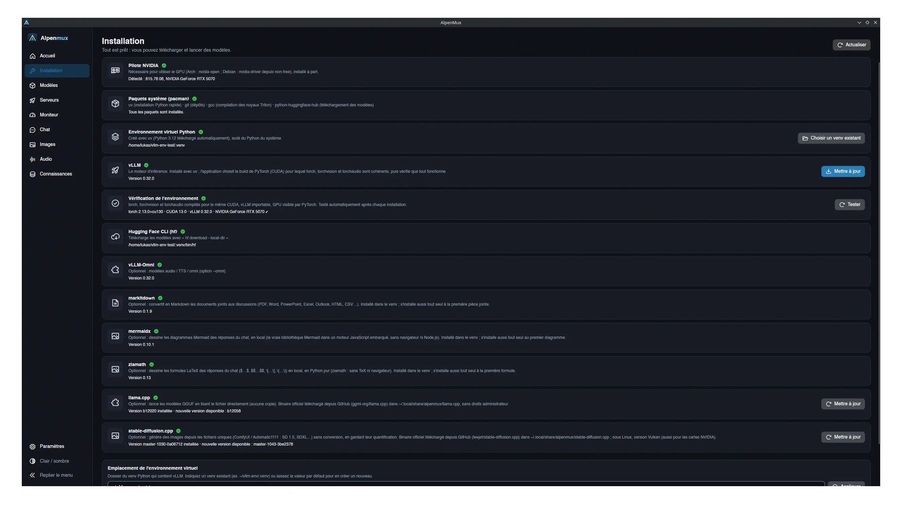</td>
    <td>Pilote NVIDIA, environnement Python, vLLM, vLLM-Omni et outils optionnels, en un clic.</td>
  </tr>
  <tr>
    <td><b>Modèles — Mes modèles</b></td>
    <td>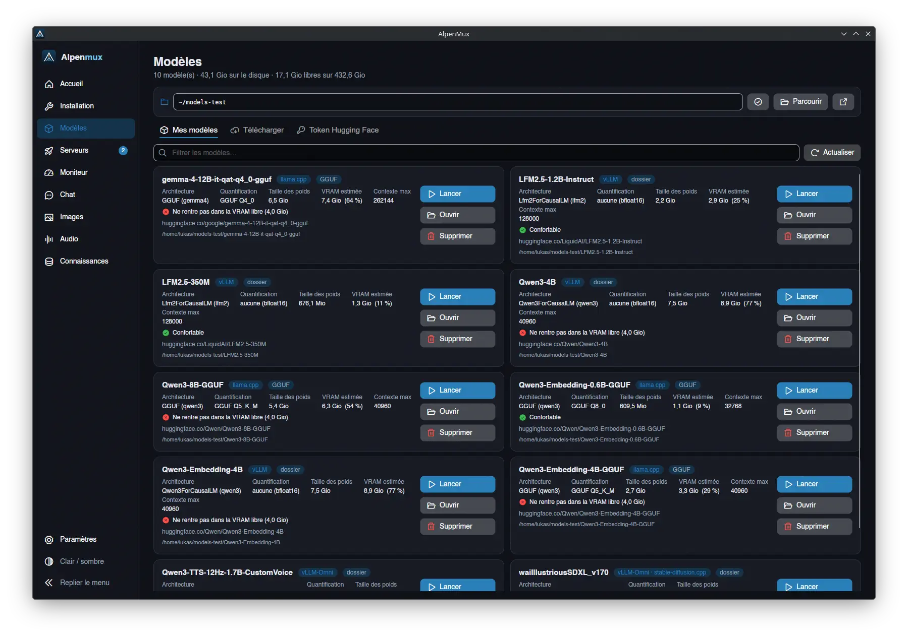</td>
    <td>Modèles présents sur le disque, avec VRAM estimée et boutons Lancer / Ouvrir / Supprimer.</td>
  </tr>
  <tr>
    <td><b>Modèles — Télécharger</b></td>
    <td>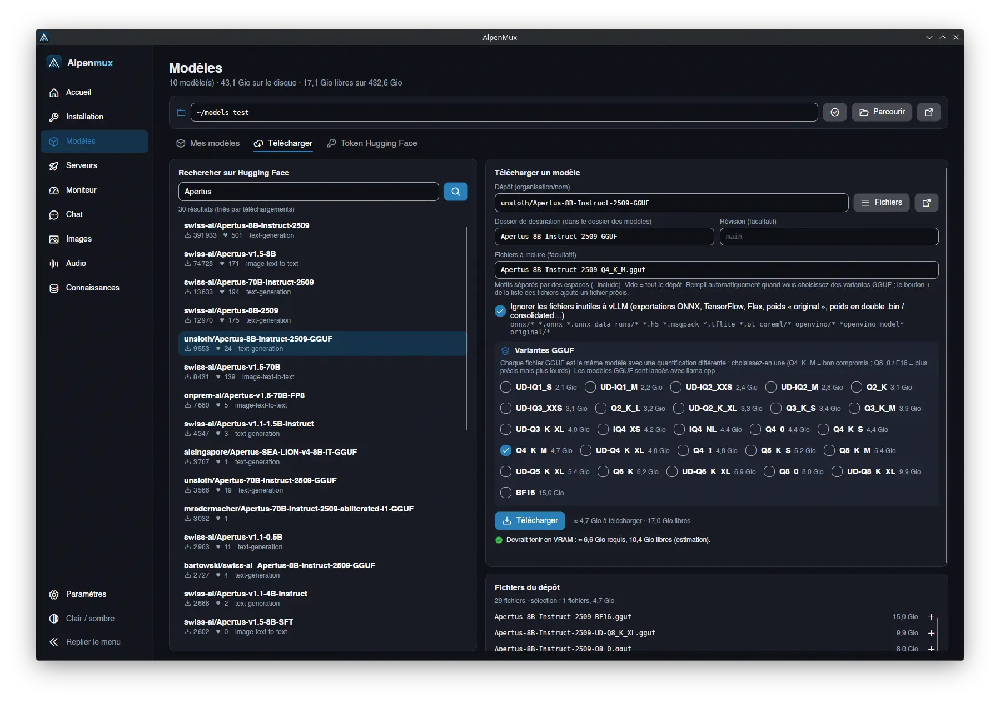</td>
    <td>Recherche Hugging Face, choix des variantes GGUF, taille à télécharger.</td>
  </tr>
  <tr>
    <td><b>Serveurs — liste</b></td>
    <td>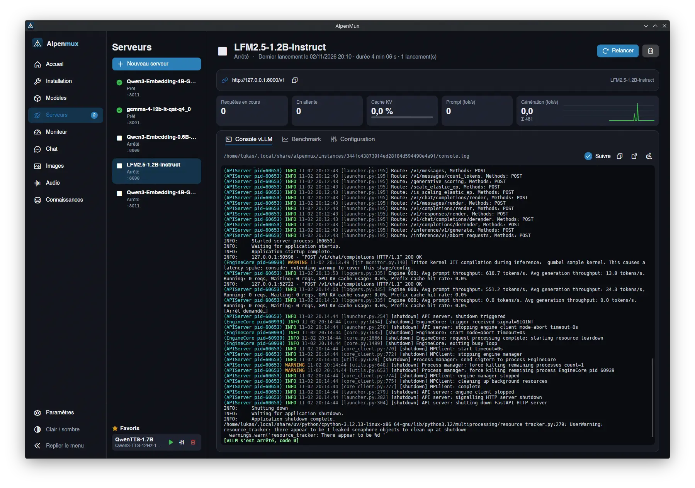</td>
    <td>Serveurs prêts, arrêtés ou en démarrage, console vLLM et métriques.</td>
  </tr>
  <tr>
    <td><b>Serveurs — nouveau serveur</b></td>
    <td>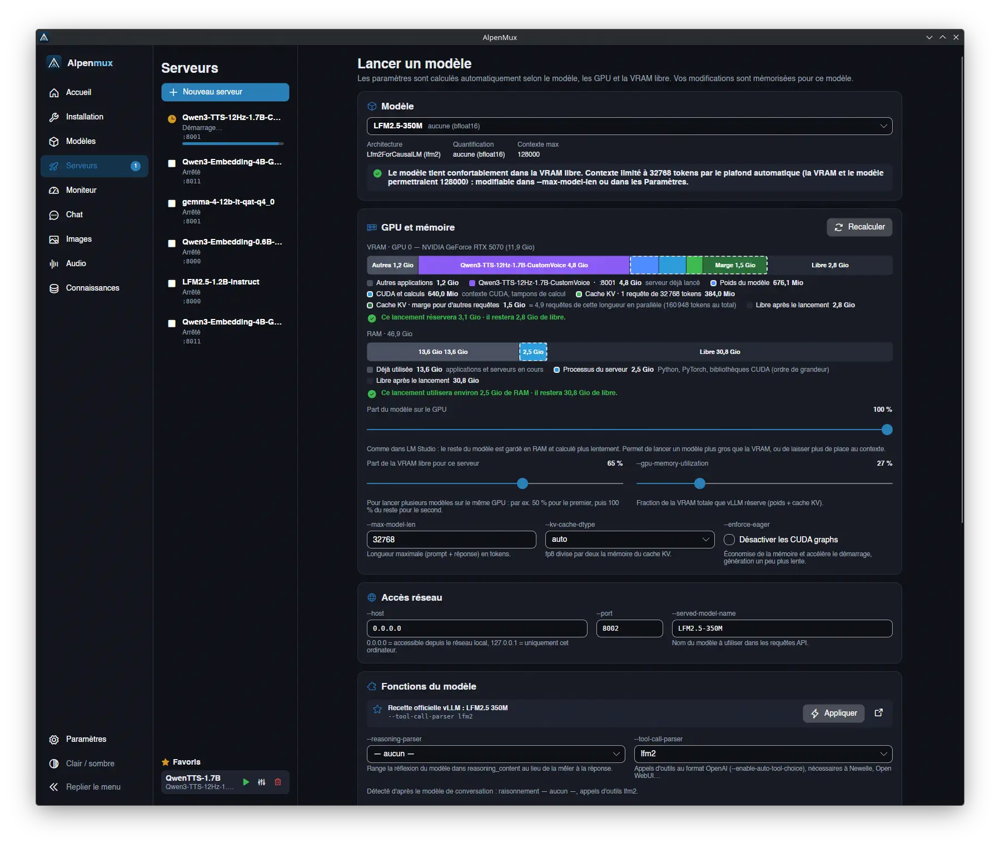</td>
    <td>Formulaire de lancement avec VRAM et RAM prévues, réglages calculés, fonctions du modèle.</td>
  </tr>
  <tr>
    <td><b>Chat</b></td>
    <td>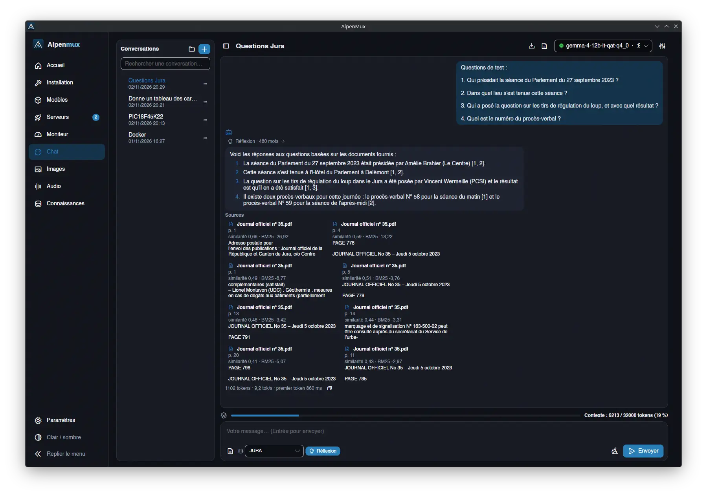</td>
    <td>Discussion avec une base de connaissances ; les réponses citent leurs sources.</td>
  </tr>
  <tr>
    <td><b>Connaissances</b></td>
    <td>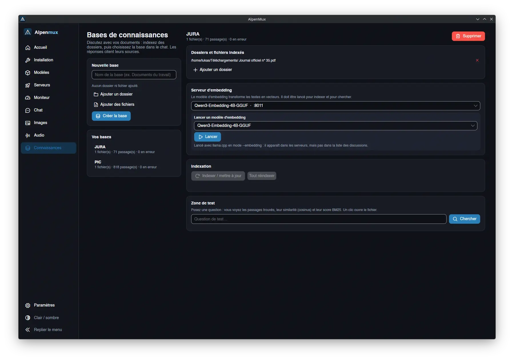</td>
    <td>Bases de connaissances (RAG), serveur d'embedding, indexation et zone de test.</td>
  </tr>
  <tr>
    <td><b>Images</b></td>
    <td>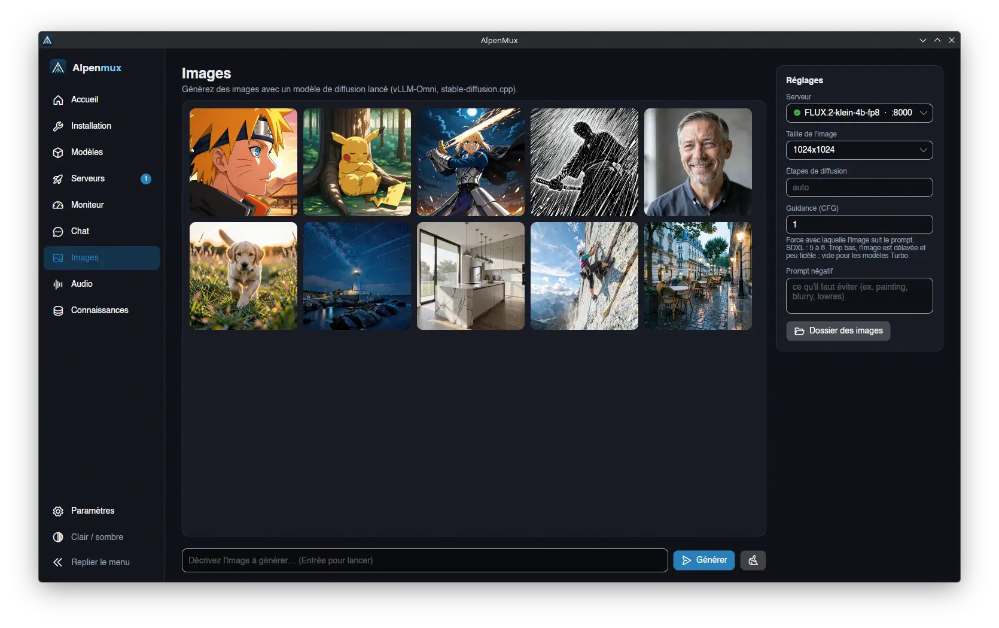</td>
    <td>Galerie de générations et réglages : taille, étapes, guidance, prompt négatif.</td>
  </tr>
  <tr>
    <td><b>Images — détail</b></td>
    <td>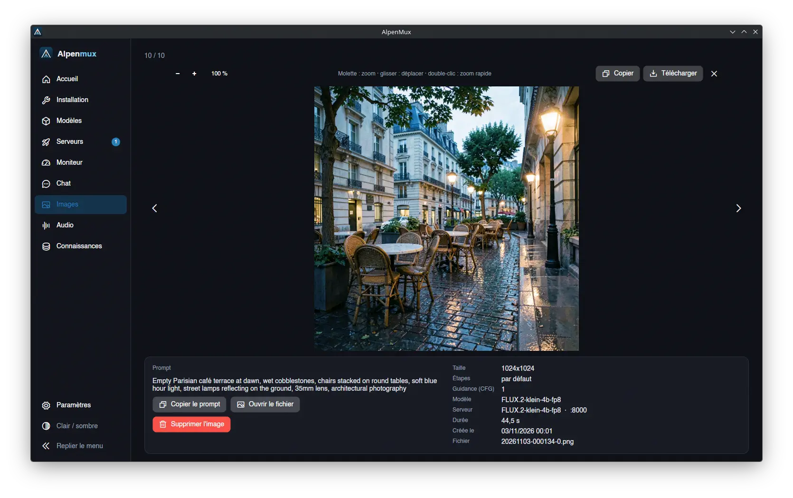</td>
    <td>Carrousel : prompt, réglages, modèle, serveur et durée de génération.</td>
  </tr>
  <tr>
    <td><b>Audio</b></td>
    <td>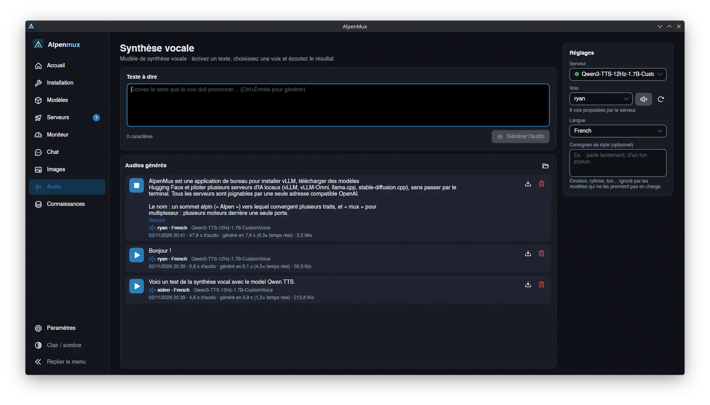</td>
    <td>Synthèse vocale : texte, voix, langue, audios générés.</td>
  </tr>
  <tr>
    <td><b>Moniteur</b></td>
    <td>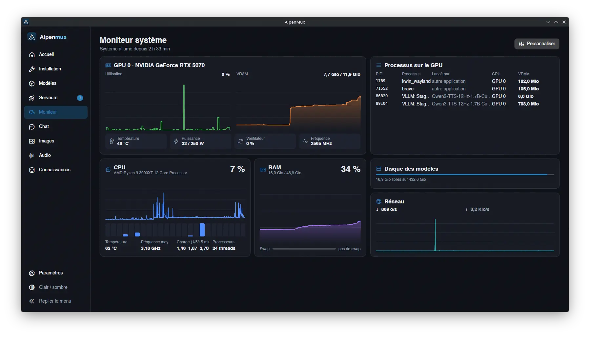</td>
    <td>GPU, VRAM, CPU, RAM, disque des modèles et processus GPU.</td>
  </tr>
  <tr>
    <td><b>Paramètres</b></td>
    <td>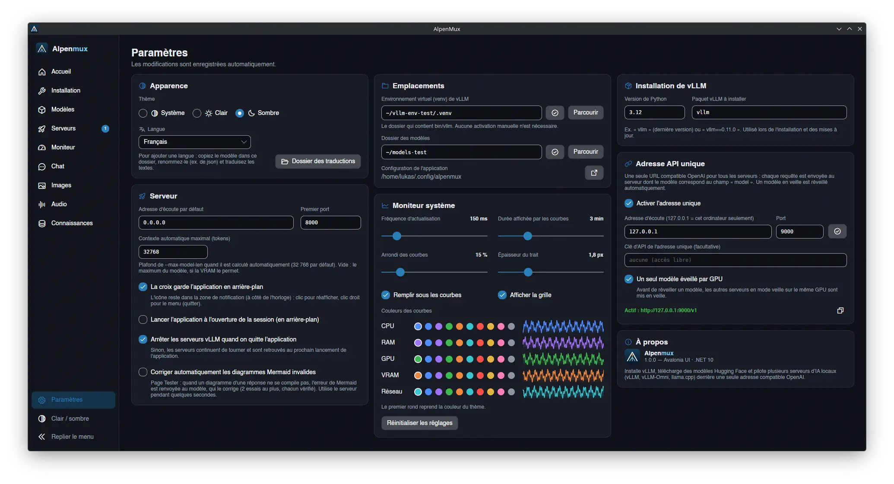</td>
    <td>Apparence, emplacements, serveur, adresse API unique, moniteur système.</td>
  </tr>
</table>

## Lancer

Fonctionne sur **Arch** (et dérivées : EndeavourOS, Manjaro), **Debian** (et dérivées : Ubuntu, Mint) et
**Windows 10 / 11** (64 bits ; vLLM y tourne dans WSL2, voir [Windows](#windows)).

```bash
dotnet run                 # en développement
./publish.sh               # exécutable autonome dans ./publish/alpenmux
./publish.sh --install     # + entrée dans le menu des applications et commande `alpenmux`
```

## Paquets d'installation

```bash
./build.sh                 # les trois paquets dans ./distribution
./build.sh deb             # Debian / Ubuntu : alpenmux_<version>_amd64.deb
./build.sh arch            # Arch : alpenmux-<version>-1-x86_64.pkg.tar.zst
./build.sh windows         # Windows : AlpenMux_<version>_Setup.exe (installateur NSIS)

sudo apt install ./distribution/alpenmux_<version>_amd64.deb
sudo pacman -U ./distribution/alpenmux-<version>-1-x86_64.pkg.tar.zst
```

L'installateur Windows se construit depuis Linux (compilation croisée win-x64 + `makensis`, paquet `nsis`) ;
il se lance ensuite sur le PC Windows.

Application « self-contained » (pas besoin de .NET sur la machine cible), compilée en ReadyToRun,
installée dans `/usr/lib/alpenmux`, lanceur `/usr/bin/alpenmux`, entrée de menu et icônes (toutes tailles +
SVG).
Outils : `dotnet`, plus `ar` / `xz` pour le .deb, `zstd` (et `bsdtar` pour le `.MTREE`) pour Arch.
La version est celle de `AlpenMux.csproj`.

## Comparaison avec Ollama, LM Studio et Newelle

Ces outils ne font pas tout à fait la même chose : Ollama et LM Studio *servent* des modèles (surtout au
format GGUF, avec llama.cpp), Newelle est un *assistant* qui se connecte à un fournisseur de modèles
(Ollama, une API compatible OpenAI…), AlpenMux pilote **vLLM**, un moteur de serveur pensé pour le débit.

|                                   | **AlpenMux**                                   | **Ollama**                              | **LM Studio**                          | **Newelle**                                  |
|-----------------------------------|------------------------------------------------|-----------------------------------------|----------------------------------------|----------------------------------------------|
| Rôle                              | Installer et piloter des serveurs vLLM         | Serveur de modèles + ligne de commande  | Application tout-en-un (chat + serveur)| Assistant de bureau (client)                 |
| Moteur                            | vLLM, vLLM-Omni, llama.cpp (GGUF), stable-diffusion.cpp (images) | Moteur propre basé sur llama.cpp        | llama.cpp, MLX (Mac)                   | Celui du fournisseur choisi                  |
| Formats de modèles                | safetensors, AWQ, GPTQ, FP8… ; GGUF via llama.cpp ; images : diffusers, fichiers uniques ComfyUI / Automatic1111 | GGUF (bibliothèque `ollama pull`)    | GGUF, MLX                              | —                                            |
| Plusieurs requêtes en même temps  | Excellent : batching continu, PagedAttention   | Possible, débit plus limité             | Possible, débit plus limité            | —                                            |
| Plusieurs modèles, une adresse    | Oui (routeur intégré, réveil automatique)      | Oui                                     | Oui                                    | —                                            |
| Plusieurs GPU                     | Tensor / pipeline parallel                     | Répartition des couches                 | Répartition des couches                | —                                            |
| Réglage de la VRAM                | Calculé et visualisé (barre, correction auto)  | Automatique, peu visible                | Automatique + réglages manuels         | —                                            |
| Synthèse vocale, images           | Oui (vLLM-Omni : voix, aperçu, historique ; génération d'images) | Non                   | Non                                    | Oui (moteurs de voix intégrés / externes)    |
| Chat intégré                      | Page de test (contexte en direct, images)      | Ligne de commande (app de bureau sur Windows / macOS) | Oui, complet           | Oui, complet (commandes, documents, extensions) |
| API compatible OpenAI             | Oui (vLLM)                                     | Oui                                     | Oui                                    | — (client)                                   |
| Fichiers GGUF                     | Lus directement (aucune copie)                 | Importés (copie dans sa bibliothèque)   | Lus directement                        | —                                            |
| Plateformes                       | Linux (Arch, Debian et dérivées), Windows 10 / 11 (vLLM dans WSL2), surtout NVIDIA | Linux, Windows, macOS | Linux, Windows, macOS                  | Linux (GNOME / Flatpak)                      |
| Code source                       | Ouvert                                         | Ouvert (MIT)                            | Fermé (gratuit)                        | Ouvert (GPL-3)                               |

**Quand choisir quoi**
- **AlpenMux** : servir des modèles safetensors / AWQ / GPTQ sur GPU NVIDIA à plusieurs utilisateurs ou
  applications à la fois (débit maximal), utiliser plusieurs GPU, alterner plusieurs modèles sur un GPU
  (mise en veille), tester des modèles de synthèse vocale ou d'images, et comprendre où part la VRAM.
  Contrepartie : démarrage plus long (compilation, graphes CUDA) et VRAM réservée d'avance.
- **Ollama** : lancer vite un modèle GGUF, une seule commande, sur n'importe quel système.
- **LM Studio** : découvrir et discuter avec des modèles locaux dans une interface soignée, y compris sur
  Mac (MLX) ou Windows.
- **Newelle** : un assistant au quotidien sur le bureau GNOME, branché sur Ollama, vLLM (API OpenAI) ou un
  service en ligne. Il se combine bien avec AlpenMux : celui-ci lance les serveurs, Newelle se connecte à
  l'adresse unique.

## Pages

| Page | Contenu |
|---|---|
| **Accueil** | Résumé : état de l'installation, GPU / VRAM / CPU / RAM, **adresse unique** et modèles servis, serveurs actifs, raccourcis |
| **Installation** | Pilote NVIDIA, paquets système — Arch : `uv`, `git`, `gcc`, `python-huggingface-hub` (pacman) ; Debian : `git`, `gcc`, `curl` (apt) puis `uv` par l'installateur officiel dans `~/.local/bin` — venv créé avec uv, vLLM (`uv pip install vllm --torch-backend=auto`), hf CLI, vLLM-Omni (optionnel), markitdown (optionnel, documents joints aux discussions), mermaidx (optionnel, diagrammes des réponses), llama.cpp (optionnel, binaire officiel pour les modèles GGUF), stable-diffusion.cpp (optionnel, binaire officiel pour les fichiers uniques d'images). « Tout installer » en un clic, progression avec % et temps restant, journal, commande manuelle si pkexec n'est pas disponible. S'ouvre automatiquement au démarrage s'il manque quelque chose. |
| **Modèles** | Dossier des modèles (`~/models` par défaut) · *Mes modèles* : une carte par téléchargement en cours (barre, %, vitesse, temps restant, **pause** / reprendre / annuler ; une pause est retenue à la fermeture de l'application ; nombre en cours affiché dans le menu), puis les modèles : architecture, quantification, taille, VRAM estimée (multi-GPU), ouvrir / supprimer / lancer · *Télécharger* : recherche Hugging Face, liste des fichiers, **choix des variantes GGUF** (Q4_K_M, Q8_0…), `hf download --local-dir`, plusieurs téléchargements en parallèle, taille à télécharger et place libre affichées, fichiers inutiles à vLLM **et poids en double** ignorés (variantes `.fp16`, fichiers uniques à la racine des pipelines diffusers) ; un téléchargement interrompu par la fermeture de l'application **reprend au lancement suivant**, un modèle incomplet est signalé · **fichiers uniques ComfyUI / Automatic1111** : SD 1.x / 2.x et SDXL complets lancés tels quels avec **stable-diffusion.cpp** s'il est installé ; FLUX.2, FLUX.1, Z-Image et SDXL (y compris FP8 / NVFP4) convertibles pour vLLM-Omni avec *Convertir pour vLLM* ; FLUX.2 et Z-Image (transformer seul) lançables avec stable-diffusion.cpp en indiquant le VAE et l'encodeur de texte Qwen3, à la main ou **téléchargés automatiquement** pour FLUX.2 klein 4B (format diffusers, autres composants pris dans le dépôt officiel, leur téléchargement suivi en octets) · *Token* : saisie, vérification |
| **Serveurs** | Formulaire de lancement avec valeurs automatiques (`--gpu-memory-utilization`, `--max-model-len`, `--kv-cache-dtype`, `--enforce-eager`), part de la VRAM libre pour lancer plusieurs modèles, **part du modèle sur le GPU** (le reste en RAM, comme dans LM Studio : `--cpu-offload-gb` pour vLLM, `-ngl` pour llama.cpp), **barres de prévision de la VRAM et de la RAM**, **choix automatique des GPU + tensor parallel**, **fonctions du modèle** (voir plus bas), paramètres avancés, aperçu de la commande, **favoris**. Chaque serveur : progression du démarrage, métriques temps réel, **veille / réveil**, onglets *Console*, *Benchmark* (`vllm bench serve` : requêtes de chauffe, nombre de requêtes porté à deux fois le parallélisme, avertissement quand le cache KV ou `--max-num-seqs` limite les requêtes simultanées) et *Configuration* (paramètres utilisés, « Modifier et relancer », « Ajouter aux favoris »). **L'historique (journal et mesures compris) est conservé jusqu'à la suppression du serveur**, même après fermeture de l'application. |
| **Moniteur** | GPU (utilisation, VRAM, température, puissance, ventilateur, fréquence), CPU (total, par cœur, température, charge), RAM / swap, réseau, disque des modèles, processus GPU avec le serveur qui les a lancés. Page **modulable** : bouton **Personnaliser** pour déplacer les cartes (glisser-déposer sur une grille de 12 colonnes), les redimensionner (bords et coin), en ajouter (CPU, RAM, GPU complet ou seulement utilisation / VRAM / capteurs, réseau, disque, processus ; plusieurs GPU possibles), les retirer, changer leur titre ou leur GPU ; la disposition est enregistrée. Réglages des courbes dans **Paramètres** (carte « Moniteur système ») : fréquence d'actualisation, durée d'historique, arrondi, épaisseur, aire, grille, couleur de chaque courbe. |
| **Chat** | Discussion en streaming avec un modèle de texte (API OpenAI), **conversations rangées dans des dossiers** (créer, renommer, déplacer, rechercher, supprimer ; **glisser-déposer** d'une conversation sur un dossier ou sur « Sans dossier » ; **Maj ou Ctrl maintenu** : corbeille sur chaque ligne pour supprimer sans confirmation), **gardées entre les sessions** comme dans LM Studio ; **réflexion du modèle activable** (bouton « Réflexion » de la zone de saisie, seulement pour les modèles qui savent la désactiver : `enable_thinking` du chat template), zone de saisie avec pièces jointes (Entrée pour envoyer, Maj+Entrée pour une ligne). **Réponses affichées en Markdown** (titres, listes, tableaux ; **blocs de code avec leur langue et un bouton « Copier »** ; **diagrammes Mermaid dessinés en local** par mermaidx — la vraie bibliothèque Mermaid dans un moteur JavaScript embarqué, sans navigateur ni Node.js, installée dans le venv au premier diagramme — **dès que leur bloc est fermé**, sans attendre la fin de la réponse ; diagramme invalide corrigé par le modèle à la fin de la réponse si l'option est active dans les Paramètres) ; **formules LaTeX** (`$…$`, `$$…$$`, `\[…\]`, `\(…\)`) dessinées en local par ziamath (Python pur : sans TeX ni navigateur), installé dans le venv à la fin de la première réponse qui en contient, et copiables, statistiques de génération sous chaque réponse, réflexion repliée par défaut, contexte en direct (documents joints comptés avec le tokenizer du serveur, `/tokenize` ; avertissement au-delà de 75 %), **images jointes** pour les modèles vision, **documents joints** (texte, PDF, Word, PowerPoint, Excel, Outlook, HTML, CSV… convertis en Markdown par markitdown, installé dans le venv à la première pièce jointe ; le modèle reçoit le Markdown entre balises `<document>`). Réglages repliables : température, tokens max, **échantillonnage** (Top-P, Top-K, Min-P, pénalités de fréquence, de présence et de répétition ; envoyés seulement s'ils diffèrent du réglage neutre), **personas** (prompts système prédéfinis : développeur, écrivain, analyste, professeur, traducteur, brainstorming), prompt système (par conversation), **outils** (tableau JSON au format OpenAI envoyé en `tools` ; les appels d'outils reçus sont affichés dans la réponse, sans être exécutés), **copie de la commande cURL** qui rejoue la conversation (bash sous Linux, PowerShell + `curl.exe` sous Windows). **export de la conversation en Markdown** et **en PDF** (boutons de l'en-tête ; le PDF est une page HTML ouverte dans le navigateur, avec `marked.js` embarqué, et la boîte d'impression l'enregistre au format PDF). Conversations : `~/.local/share/alpenmux/chats`. |
| **Images** | Génération d'images avec un serveur de diffusion lancé (vLLM-Omni, stable-diffusion.cpp), page séparée du chat. **Galerie** des images de la session : un clic ouvre un **carrousel** (flèches ← →, Échap) dont le bas donne les informations de la génération (prompt, négatif, taille, étapes, guidance, modèle, serveur, durée, fichier ; copier le prompt, ouvrir le fichier). prompt, prompt négatif, taille, étapes, **guidance (CFG) préremplie selon le modèle** (sans elle vLLM-Omni prend 1,0 : images délavées), images conservées dans `~/.local/share/alpenmux/images` (PNG + `.json` avec le prompt et les réglages) jusqu'à suppression : une image ou toute la galerie, après confirmation. Au lancement, l'encodeur de texte d'un modèle d'image trop gros peut rester en RAM (`--enable-cpu-offload`, coché d'office quand il le faut) : FLUX.2 klein 4B tient ainsi sur 12 Go. |
| **Audio** | Synthèse vocale, page séparée du chat. texte à dire, voix (liste du serveur `/v1/audio/voices`, sinon `config.json`), langue, consignes de style, pré-écoute d'une voix (mise en cache), audios générés conservés dans `~/.local/share/alpenmux/tts` avec leurs informations (écouter, télécharger, supprimer). Lecture via pw-play / paplay / ffplay / mpv / aplay. |
| **Connaissances** | Bases de connaissances (RAG) : une base = des dossiers et fichiers (PDF, Word, Excel, Markdown, texte, code…). Indexation en tâche de fond avec progression, annulation et reprise, incrémentale (seuls les fichiers modifiés sont relus). Embeddings par un serveur lancé ici (modèle GGUF en mode `--embedding`, llama.cpp) ou déjà lancé dans **Serveurs**. Recherche hybride (similarité vectorielle + BM25, fusion RRF), zone de test avec les scores. Index dans `~/.local/share/alpenmux/rag/<id>/index.db`. Dans le chat, choisir la base de la conversation : les passages pertinents sont passés au modèle et listés sous la réponse, cliquables. |
| **Paramètres** | Thème clair / sombre / système, langue, chemins, version de Python, paquet vLLM à installer, adresse et port par défaut, **contexte automatique maximal**, **adresse API unique** (adresse, port, clé, un seul modèle éveillé par GPU), arrêt des serveurs à la fermeture, **correction automatique des diagrammes Mermaid invalides** (l'erreur de Mermaid est renvoyée au modèle, réflexion désactivée, 2 essais au plus, chacun vérifié). |

Les valeurs modifiées dans le formulaire de lancement sont mémorisées **par modèle** ; la mémoire
et le contexte sont recalculés à chaque fois à partir de la VRAM libre (sauf valeur forcée).

## Adresse API unique

Un routeur intégré écoute sur `http://127.0.0.1:9000/v1` (réglable dans les Paramètres) : Newelle,
Open WebUI ou tout client OpenAI n'ont qu'une URL à connaître.

* `GET /v1/models` liste les modèles de tous les serveurs prêts (adaptateurs LoRA compris).
* Les autres requêtes sont envoyées au serveur dont le modèle correspond au champ `model` (JSON, ou
  formulaire pour la transcription audio) ; la réponse est transmise en flux (streaming SSE).
* Un serveur en veille est réveillé avant la requête. Avec « Un seul modèle éveillé par GPU », les autres
  serveurs en mode veille du même GPU sont d'abord mis en veille.
* La clé d'API de chaque serveur est ajoutée par le routeur ; le routeur peut avoir sa propre clé.

## Fonctions du modèle

Dans le formulaire de lancement, selon le modèle et le vLLM installé :

* **Raisonnement et appels d'outils** : `--reasoning-parser` et `--tool-call-parser` (+ `--enable-auto-tool-choice`)
  détectés d'après le modèle de conversation (`chat_template`) et les tokens du tokenizer, pas d'après le nom
  (Qwen3 → `hermes`, mais Qwen3-Coder → `qwen3_coder`). Seuls les parsers présents dans le vLLM installé sont
  proposés, et un parser à `<think>` seulement si le tokenizer connaît `<think>` et `</think>`.
* **Recette officielle vLLM** : réglages recommandés par [recipes.vllm.ai](https://recipes.vllm.ai). « Appliquer » indique sous la recette ce qui a été ajouté, ou que tout est déjà en place.
  (gardés en cache), appliqués en un clic.
* **Texte seul** (modèles multimodaux) : `--language-model-only` (ou `--limit-mm-per-prompt` à 0 sur les anciens
  vLLM) ; l'encodeur vision / audio n'est pas chargé, la VRAM économisée est mesurée dans les fichiers.
* **Mise en veille** : `--enable-sleep-mode` ; bouton Veille / Réveiller sur le serveur. Les routes `/sleep` et
  `/wake_up` demandent `VLLM_SERVER_DEV_MODE=1` et ne sont pas protégées : le serveur n'écoute alors que sur
  127.0.0.1 (l'adresse unique reste utilisable).
* **Adaptateurs LoRA** : les dossiers `adapter_config.json` du dossier des modèles entraînés pour ce modèle,
  servis avec `--enable-lora --lora-modules nom=chemin` (`--max-lora-rank` calculé).
* **Décodage spéculatif MTP** (DeepSeek, Qwen3-Next, GLM…) : `--speculative-config` avec la méthode adaptée à la
  version de vLLM.

## Garde-fous

* **Environnement Python** : avant d'installer vLLM, l'application simule l'installation pour chaque
  build PyTorch compatible avec le pilote (cu132, cu130, cu128…) et garde le premier où torch,
  torchvision et torchaudio viennent du même build (avec vLLM 0.32 : cu130, car torchaudio 2.11.0
  n'existe pas en cu132). Le build est mémorisé dans le venv (`.alpenmux-torch-backend`) et la
  famille torch est figée (`.alpenmux-constraints.txt`) : installer vLLM-Omni ou hf ne peut plus la
  modifier. Après chaque installation : vérification statique + test réel (import de vLLM, GPU visible,
  architecture du GPU prise en charge). En cas d'échec : réparation automatique, puis retour à l'état
  précédent. L'élément « Vérification de l'environnement » de la page Installation refait le test
  (automatiquement quand le venv change) et propose « Réparer ». Un lancement est refusé tant que
  l'environnement est incohérent.
* **Options de vLLM** : la liste des options du vLLM installé est lue une fois (`vllm serve --help=all`,
  en cache par version) ; une option inconnue de cette version est refusée avant le lancement.
* **Modèles** : formats d'autres moteurs (MLX, EXL2, ONNX seul), quantifications et architectures
  sont vérifiés à partir du vLLM installé ; un modèle incompatible ne peut pas être lancé et la raison
  est affichée (aussi avant le téléchargement). bfloat16 est remplacé par float16 sur les GPU qui ne
  le gèrent pas.
* **Erreurs** : les échecs de vLLM sont traduits en clair (environnement, pilote, mémoire, contexte,
  port, token, format, option inconnue, parser incompatible, quantification forcée, dépôt introuvable,
  LoRA, veille, MTP…) avec un bouton vers l'endroit où corriger.

## Calcul de la VRAM

* **Poids** : seuls les fichiers que vLLM charge sont comptés (l'index `model.safetensors.index.json` fait foi ;
  `.bin` / `.pt` en double et `consolidated.safetensors` des dépôts Mistral sont ignorés), et ils ne sont pas
  téléchargés quand l'option « Ignorer les fichiers inutiles » est cochée.
* **Cache KV** : les couches à fenêtre glissante (Gemma, gpt-oss…) ne gardent que la fenêtre ; vLLM range
  toutes les couches dans des pages de même taille, chaque couche compte donc comme la plus grosse
  (Gemma 4 12B : 2,35 Gio pour 32 768 tokens, la valeur annoncée par vLLM). Fichiers GGUF : têtes et motif de
  fenêtre glissante lus dans les métadonnées, comme llama.cpp.
* **Modèles d'image** (diffusers) : seuls les composants listés dans `model_index.json` comptent, poids fp32 comptés
  en 16 bits (vLLM-Omni les charge en bf16) ; encodeurs de texte retirés quand ils restent en RAM.
* **Avant téléchargement** : le `config.json` du dépôt est lu sur Hugging Face (GGUF exclus) : même calcul que
  pour un modèle local (cache KV, contexte, compatibilité vLLM : formats, quantification, architecture, tokenizer).
  Sans config.json (ou en GGUF), le verdict reste une estimation d'après la taille des fichiers choisis.
* **Surcoût** : contexte CUDA, activations, graphes CUDA, plus un terme proportionnel au vocabulaire
  (logits pendant le profilage) ; le contexte CUDA du nouveau processus (≈ 0,55 Gio) est retiré de la VRAM libre.
* **Part du modèle sur le GPU** : le reste des poids est compté en RAM (vLLM : `--cpu-offload-gb`, par GPU ;
  llama.cpp : couches hors `-ngl`), ce qui laisse plus de VRAM au cache KV.
* **RAM** : barre de prévision sous celle de la VRAM : RAM déjà utilisée, processus du serveur (ordre de grandeur :
  vLLM ≈ 2,5 Gio, vLLM-Omni ≈ 3 Gio, llama.cpp / stable-diffusion.cpp ≈ 0,5 Gio), poids gardés en RAM (déchargement,
  encodeur de texte, poids pendant la mise en veille), libre ensuite ; alerte si le fichier d'échange serait utilisé.
* **Contexte automatique** : plafonné à 32 768 tokens par défaut (réglable dans les Paramètres, vide = maximum du
  modèle) ; le plafond est signalé quand la VRAM permettrait plus.

## Windows

vLLM ne fonctionne que sous Linux : sous Windows, AlpenMux le fait tourner dans **WSL2** et s'occupe de tout.

**Installateur** (`AlpenMux_<version>_Setup.exe`, NSIS, français / anglais selon Windows) : application dans
`Program Files\AlpenMux`, raccourcis menu Démarrer / bureau, composants au choix :

| Composant | Rôle |
|---|---|
| AlpenMux (requis) | Application autonome (pas de .NET à installer), inscription dans « Applications installées » |
| Raccourci sur le bureau | Coché par défaut |
| WSL2 | `wsl --install --no-distribution` si WSL2 n'est pas encore activé ; redémarrage proposé à la fin |
| Lancer à l'ouverture de session | Démarrage en arrière-plan (zone de notification) |

L'installateur réserve aussi le port 9000 de l'adresse unique (`netsh http add urlacl url=http://+:9000/`) : sans cela,
Windows n'autorise que `localhost`. Une version déjà installée est détectée (désinstallation proposée). La
désinstallation demande s'il faut aussi supprimer les réglages, l'historique et la distribution WSL ; les modèles
ne sont jamais supprimés. Les images de l'installateur se refont avec `python3 packaging/windows/make_images.py`.

**Page Installation** (« Tout installer ») : deux étapes en plus, avant celles de Linux :

1. **WSL2** : s'il manque (installateur non utilisé), activation avec la fenêtre UAC de Windows, puis redémarrage.
2. **Distribution « AlpenMux »** : image officielle d'Ubuntu 24.04 pour WSL, importée avec `wsl --import`
   dans `%LOCALAPPDATA%\alpenmux\wsl\AlpenMux` (séparée des autres distributions WSL ; WSL mis à jour si l'import
   est refusé). `/etc/wsl.conf` : root par défaut, PATH de Windows non ajouté. Le GPU NVIDIA vu depuis Linux est affiché.

Ensuite, comme sous Linux, dans la distribution et en root (pas de mot de passe) : paquets apt (`git`,
`build-essential`, `curl`), uv, venv `/root/vllm-env/.venv`, vLLM, hf, vLLM-Omni.

**Fonctionnement**
* Les commandes Linux passent par `wsl.exe -d AlpenMux -u root --exec env …` : arguments transmis tels quels.
* Chemins : les dossiers Windows sont donnés à vLLM en `/mnt/c/…` ; l'application lit le venv par
  `\\wsl.localhost\AlpenMux\…`. Les modèles restent par défaut dans `%USERPROFILE%\models` ; pour un chargement plus
  rapide par vLLM, ils peuvent aussi être placés dans la distribution (dossier `\\wsl.localhost\AlpenMux\root\models`).
* Serveurs vLLM : le shell de lancement écrit son groupe de processus Linux dans `instances\<id>\pid` ; arrêt, Ctrl+C
  et reprise après redémarrage de l'application passent par `kill` dans la distribution. WSL transmet les ports
  à Windows : `http://127.0.0.1:<port>/v1` fonctionne comme sous Linux.
* **llama.cpp** tourne **nativement** sous Windows (archive officielle `-bin-win-cuda-13.x` / `12.x` + `cudart`, ou
  Vulkan) ; `cmd.exe` écrit sa sortie dans le journal, le serveur survit à la fermeture de l'application.
* Moniteur : CPU, RAM et réseau par les API de Windows, GPU par `nvidia-smi.exe` (pas de température CPU).
* Audio : ffplay ou mpv s'ils sont installés, sinon le lecteur WAV de Windows. Lancement automatique : clé
  `HKCU\…\Run`. Réglages dans `%APPDATA%\alpenmux`, données dans `%LOCALAPPDATA%\alpenmux`.
* WSL2 limite la RAM de Linux à la moitié de celle du PC par défaut (fichier `%USERPROFILE%\.wslconfig`) : à
  prendre en compte pour la mise en veille, qui garde les poids en RAM.

## Arrière-plan

La croix masque la fenêtre : l'application reste dans la zone de notification (icône à côté de
l'horloge). Clic sur l'icône = afficher / masquer ; menu = afficher, arrêter tous les serveurs, quitter.
Relancer l'application réaffiche la fenêtre existante (une seule instance). `alpenmux --minimized`
démarre directement en arrière-plan ; une option des Paramètres l'ajoute au démarrage de la session.
Si « Arrêter les serveurs en quittant » est désactivé, les serveurs continuent après la fermeture
et sont retrouvés (journal, métriques, arrêt, adresse unique) au lancement suivant.

## Multi-GPU

Indices identiques à `nvidia-smi` (`CUDA_DEVICE_ORDER=PCI_BUS_ID`). Par défaut, l'application choisit
le plus petit nombre de GPU sur lequel le modèle tient (les plus libres d'abord) et règle
`--tensor-parallel-size` en conséquence ; le tensor parallel doit diviser le nombre de têtes
d'attention et chaque GPU porte sa part (le GPU le moins libre limite). `--pipeline-parallel-size`
est disponible dans les paramètres avancés. Un serveur par GPU est aussi possible (décocher les autres).

## Fichiers uniques d'images → stable-diffusion.cpp

Les fichiers uniques au format ComfyUI / Automatic1111 (un `.safetensors` sans `model_index.json`, comme sur Civitai)
ne se chargent pas dans vLLM-Omni. Deux possibilités, au choix sur la carte du modèle :

* **Lancer** avec **stable-diffusion.cpp** (`sd-server`) : le fichier est lu directement, sans conversion ni copie,
  en gardant sa quantification ; SD 1.x / 2.x (que vLLM-Omni ne gère pas) et SDXL. Installation depuis la page
  Installation, sans droits administrateur : binaire officiel des publications GitHub de `leejet/stable-diffusion.cpp`
  (Linux : Vulkan, aussi pour les cartes NVIDIA, faute de binaire CUDA publié ; ROCm pour AMD ; Windows : CUDA 12 +
  `cudart`, sinon Vulkan) dans `~/.local/share/alpenmux/stable-diffusion.cpp/current`, bouton « Mettre à jour ».
  Les poids qui ne tiennent pas sur le GPU sont placés en RAM automatiquement ; l'option « Garder les poids en RAM »
  (`--offload-to-cpu`) sert quand un autre modèle occupe déjà la carte. API compatible OpenAI
  (`/v1/images/generations`, utilisée par l'adresse unique) et Automatic1111 (`/sdapi/v1/txt2img`, utilisée par la
  page Images : étapes, guidance, prompt négatif).
* **Convertir pour vLLM** : format diffusers dans le même dossier (voir *Modèles*), pour profiter de vLLM-Omni.
  Seule possibilité pour FLUX et Z-Image, dont le fichier ne contient que le transformer. Proposée aussi quand
  stable-diffusion.cpp est installé (sauf SD 1.x / 2.x, que vLLM-Omni ne gère pas).

Un modèle converti garde son fichier d'origine : le formulaire de lancement propose alors le **moteur** au choix,
vLLM-Omni (version convertie, plusieurs requêtes à la fois) ou stable-diffusion.cpp (fichier d'origine).

## GGUF → llama.cpp

Les fichiers `.gguf` ne sont pas lancés avec vLLM (son support GGUF est trop instable) mais avec
**llama.cpp** (`llama-server`), qui lit le fichier directement : aucun import, aucune copie.
Installation depuis la page Installation, sans droits administrateur : le binaire officiel précompilé
(publications GitHub de `ggml-org/llama.cpp`, variante CUDA 13 / CUDA 12 selon le pilote, ROCm ou Vulkan)
est extrait dans `~/.local/share/alpenmux/llama.cpp/current` ; un bouton « Mettre à jour » apparaît quand
une nouvelle version est publiée. Si les bibliothèques CUDA du système manquent, l'archive `cudart` est ajoutée.
Réglages : contexte (`-c`, estimé d'après la VRAM), couches sur le GPU (`-ngl`, toutes par défaut),
cache KV (`f16`, `q8_0`, `q4_0`), clé d'API, arguments supplémentaires. Suivi comme un serveur vLLM :
progression, journal, `/health`, métriques (`--metrics`), page Chat (API compatible OpenAI), adresse unique.

## Configuration

`~/.config/alpenmux/settings.json` (permissions 600, contient le token HF s'il est renseigné, les favoris
et les réglages mémorisés par modèle). Caches : `vllm-options.json` (options du vLLM installé), `recipes/`
(recettes vLLM). Historique des serveurs : `~/.local/share/alpenmux/instances/<id>/`
(`instance.json` + `console.log` écrit directement par vLLM + `bench-*.json` des mesures). Téléchargements en cours
ou en pause : `~/.local/share/alpenmux/downloads.json` ; images générées : `images/` ; script de conversion extrait : `scripts/`.
Le venv n'a jamais besoin d'être activé : `PATH`, `VIRTUAL_ENV`, `HF_HUB_CACHE` et `HF_TOKEN` sont
passés aux processus lancés. Les serveurs tournent dans leur propre session (`setsid`) et sont
arrêtés avec tous leurs enfants (SIGINT → SIGTERM → SIGKILL), ce qui libère la VRAM.

## Traductions

Textes dans `Assets/Lang/fr.json` (référence) et `Assets/Lang/en.json`.

* Dans le XAML : `Text="{l:Tr Cle}"` ; en C# : `Loc.T("Cle")` / `Loc.F("Cle", arg)`.
* Ajouter une langue **sans recompiler** : Paramètres → « Dossier des traductions », copier
  `template.json.example` en `de.json` (par exemple), traduire les valeurs et `_name`.
  La langue apparaît dans la liste au prochain démarrage. Une clé absente retombe sur le français.
* Pour l'intégrer à l'application : ajouter le fichier dans `Assets/Lang/` et son code dans
  `Loc.AvailableLanguages()`.

## Logo

Kit complet dans `alpenmux-logo.zip` (SVG, PNG, favicon, arborescence `hicolor`). Utilisés par l'application :
`Assets/icon.png` (256 px) et `Assets/icon-64.png` (fenêtre, menu latéral, zone de notification),
`packaging/linux/icons/hicolor/` (paquets et `publish.sh --install`), `docs/logo/` (ce fichier).
Couleurs : bleu glacier `#1F78AB` / `#7CC4E8` (accent de l'interface), orange alpenglow `#E8641A` / `#FF8A3D`.

## Structure

```
Services/     logique sans interface ; chaque service avec état ou entrées-sorties a son interface I<Nom>
              et est fourni par le conteneur d'injection de dépendances
  ServiceRegistration  enregistrement des services et ViewModels dans le conteneur (construit au démarrage par App)
  StderrLogger         journalisation (Microsoft.Extensions.Logging) des avertissements sur la sortie d'erreur
  AppPaths             nom de l'application, dossier
  LinuxHost            « côté Linux » : la machine sous Linux, la distribution WSL sous Windows (chemins, commandes)
  WslService           Windows : installation de WSL2 et de la distribution AlpenMux
  WindowsSystemInfo    Windows : CPU, mémoire, réseau (équivalents de /proc)
  DependencyService    vérification / installation (distribution, pacman / apt, uv, venv, vLLM)
  PythonEnvironment    lecture du venv : outils (uv, hf…), chemins, versions des paquets installés
  UvPipInstaller       uv pip install dans le venv avec progression (octets, temps restant)
  HfService            API Hugging Face + hf download avec progression, poids en double exclus
  DownloadStore        téléchargements en cours ou en pause, repris au lancement suivant
  SingleFileConverter  fichiers uniques ComfyUI -> format diffusers (Assets/Scripts/convert_single_file.py)
  MarkItDownService    documents joints aux discussions -> Markdown (markitdown dans le venv)
  MermaidService       diagrammes Mermaid des réponses -> PNG, en local (mermaidx dans le venv, Assets/Scripts/render_mermaid.py)
  LatexService         formules LaTeX des réponses -> SVG (ziamath dans le venv, Assets/Scripts/render_latex.py) -> PNG (Svg.Skia)
  ModelScanner         détection des modèles (dossier --local-dir, cache HF, diffusers, adaptateurs LoRA),
                       poids réellement chargés, cache KV (fenêtre glissante)
  SafetensorsReader    en-têtes safetensors (taille des encodeurs vision / audio, poids en 16 bits), index des poids
  ArgsPlanner          calcul automatique des arguments vLLM, choix des GPU
  DownloadFit          verdict « tiendra en VRAM ? » avant téléchargement, repli quand le config.json n'est pas lu (taille des fichiers choisis)
  RemotePreview        aperçu d'un dépôt avant téléchargement : config.json lu sur Hugging Face (cache KV, contexte, compatibilité vLLM)
  ModelFit             verdict « tient / ne tient pas » commun à la carte d'un modèle et à l'aperçu avant téléchargement
  ChatParsers          choix des parsers de raisonnement et d'appels d'outils
  ChatStore            conversations et dossiers de la page Chat (chats/index.json, un fichier par conversation)
  ChatHtmlExport       export PDF du chat : page HTML autonome (marked.js embarqué, Assets/Scripts/marked.min.js),
                       ouverte dans le navigateur qui enregistre le PDF
  VllmOptions          options du vLLM installé (vllm serve --help=all, en cache)
  VllmRecipes          recettes officielles (recipes.vllm.ai)
  ApiRouter            adresse API unique (routage selon "model", réveil des serveurs en veille)
  LaunchConfig         configuration d'un lancement (arguments, favoris, historique)
  InstanceStore        historique des serveurs sur le disque
  GgufReader           métadonnées des fichiers GGUF
  OmniDeploy           étapes vLLM-Omni et répartition de la VRAM (--stage-overrides)
  TtsStore             audios TTS conservés, détection des modèles TTS, voix / langues du config.json
  AudioPlayer          lecture audio via un lecteur en ligne de commande
  EmbeddingProfiles    préfixes requête / passage par famille de modèle d'embedding (e5, Qwen3-Embedding, nomic…)
  EmbeddingClient      POST /v1/embeddings (lots, normalisation, réessais)
  RagChunker           découpage Markdown en passages (titres, tableaux et blocs de code intacts, pages)
  RagStore             bases (base.json) et index SQLite : FTS5, vecteurs en BLOB, recherche hybride RRF
  RagIndexer           indexation incrémentale (taille, date, SHA-256), conversion par lot (rag_convert.py)
  RagSearch            recherche d'une question et bloc <context> envoyé au modèle (budget de tokens)
  LlamaCppService      installation / mise à jour de llama.cpp (binaire officiel GitHub)
  PrebuiltBinaries     commun à llama.cpp et stable-diffusion.cpp : publications GitHub, téléchargement avec
                       progression, installation (extraction, vérification, remplacement de la version en service)
  StableDiffusionCppService  installation / mise à jour de stable-diffusion.cpp (sd-server, binaire officiel GitHub)
  SdComponentService   VAE et encodeur de texte de FLUX.2 klein 4B (téléchargement depuis Comfy-Org, rangés dans ~/.local/share/alpenmux/image-components)
  ModelCompat          compatibilité modèle / vLLM installé avant le lancement (formats, quantification, architecture)
  ErrorExplainer       erreurs de vLLM (traces Python) -> explication claire + action proposée
  EnvironmentChecker   garde-fou du venv (torch / torchvision / torchaudio compilés pour le même CUDA, test réel)
  VramUsage            répartition de la VRAM occupée (autres applications, un segment par serveur, libre)
  TrayService          zone de notification, fermeture
  SingleInstance       une seule instance (socket Unix)
  AutostartService     lancement à l'ouverture de session
  SystemMonitorService mesures CPU / RAM / réseau / GPU (nvidia-smi, amdgpu)
  MonitorLayout       catalogue des widgets du moniteur, disposition par défaut, calcul des positions sur la grille (collisions, compactage)
  ProcessRunner        processus, lecture des flux (\r et \n), arrêt du groupe
  ProgressTracker      %, vitesse, temps restant
  BackgroundTicker     action répétée chaque seconde pendant une opération longue (suivi des téléchargements)
  Localization         traductions + extension XAML {l:Tr}
  SettingsService      réglages (~/.config/alpenmux/settings.json)
  AppState             état partagé entre les pages (modèles détectés, serveurs lancés, navigation)
  UiServices           depuis les ViewModels : presse-papiers, choix de dossier, ouverture de liens, thème
  Icons                codes des icônes Phosphor côté C# (côté XAML : ressources Icon* de App.axaml)
  Converters, RingBuffer  convertisseurs des vues, historique des courbes
ViewModels/   une classe par page (+ InstanceViewModel = un serveur, créé par InstanceViewModelFactory ;
              BenchmarkViewModel = son onglet Benchmark)
Views/        MainWindow + Pages/*.axaml
Controls/     Sparkline (courbes), TileBoard (grille de widgets déplaçables et redimensionnables du moniteur), AutoScroll (consoles), AnsiText (lignes de console colorées), VramBar / VramPanel,
              ColumnsPanel (base des panneaux en colonnes) : AdaptiveColumnsPanel (cartes en colonnes), MasonryPanel (cartes de hauteurs différentes rangées sans trou, page Paramètres), ChatMarkdownViewer + ChatMarkdownStyle (Markdown du chat :
              style de l'application, blocs de code avec bouton « Copier »)
Assets/       polices Helvetica et Phosphor (icônes), traductions, icônes, Scripts/ (Python : conversion des fichiers uniques,
              dessin des diagrammes Mermaid, formules LaTeX)
AGENTS.md     carte du projet pour les agents IA (CLAUDE.md l'importe)
packaging/    entrée de menu, icônes hicolor ; windows/ : installateur NSIS (script, images, textes)
docs/logo/    logo pour la documentation
```

En build Debug seulement, des variables d'environnement aident aux tests manuels : `ALPENMUX_PAGE=Launch`
(page de départ), `ALPENMUX_LAUNCH=<favori>` (lance un favori), `ALPENMUX_SERVER=1` / `ALPENMUX_TAB=<n>`
(affiche le premier serveur et un onglet), `ALPENMUX_MAXIMIZE=1`, `ALPENMUX_SCROLL=<pixels>`.
Avec `XDG_CONFIG_HOME` / `XDG_DATA_HOME`, l'application utilise des dossiers de test séparés.


## Note sur l'IA
> Ce projet est réalisé à environ 99 % avec l'IA, en *vibe coding* avec **Claude** (Anthropic).
> Le code, le README et les scripts ont été écrits en dialogue avec le modèle ; les tests se font sur matériel réel.